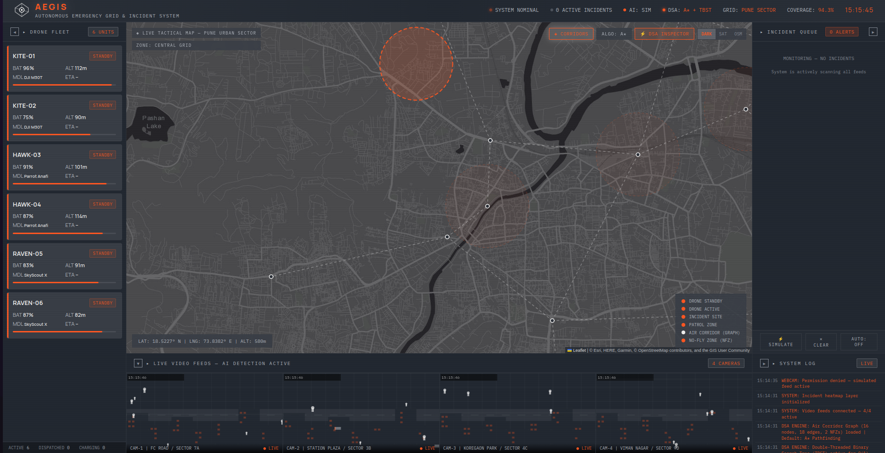

# AEGIS — Autonomous Emergency Grid & Incident System

AEGIS is a browser-based **drone-response simulation dashboard** set in Pune. It demonstrates how incident detection, drone dispatch, graph routing, restricted-airspace checks, and priority data structures can fit together in a command interface.

AEGIS is an educational simulation. It does not communicate with real drones, validate real aviation restrictions, or provide operational flight guidance.

## Dashboard preview

## Start here

Open **index.html** for the current AEGIS dashboard. For reliable map tiles and webcam access, serve the folder over HTTP instead of opening the page as a file:

    python3 -m http.server 8000

Then visit **http://localhost:8000/index.html**.

The app uses Leaflet, fonts, TensorFlow.js, COCO-SSD, and map tiles from external services. Those features need internet access. The dashboard can still generate simulated alerts when webcam permission is denied or the detection model cannot load. The map depends on its tile service.

## What the main dashboard does

- Shows a six-drone simulated fleet, battery level, status, altitude, and ETA.
- Generates simulated incidents at four Pune camera locations. The simulation also draws animated camera feeds and detection boxes.
- Optionally requests webcam access for camera 1 and runs COCO-SSD person detection when the browser, network, and model allow it.
- Places drones, incidents, air corridors, and no-fly zones on a Leaflet map.
- Routes drones over a modeled air-corridor graph using selectable algorithms.
- Queues incidents in a threaded binary search tree when no drone is available.
- Shows a live event log, route tester, map-layer controls, and DSA inspector.

## Algorithms and data structures

### Air-corridor graph

The main dashboard models Pune airspace as an undirected, weighted graph:

- **Vertices:** 16 named corridor waypoints.
- **Edges:** 18 bidirectional corridor links.
- **Edge weights:** Haversine distance in meters between waypoint coordinates.
- **Restricted zones:** Two static circles, around Pune Airport/Lohegaon AFB and the Raj Bhavan/VIP area.

The graph is an adjacency list. Each edge is checked against the restricted zones when the graph is built. The current intersection check samples points along a segment at fixed intervals; it is an approximation.

### A* search

A* is the default routing mode. It ranks candidate waypoints using:

- g(n): distance traveled through the graph so far.
- h(n): Haversine distance from the candidate waypoint to the target waypoint.
- f(n) = g(n) + h(n).

Edges marked as blocked are skipped. The current implementation sorts an array of candidates to choose the next node; it does not use a heap. This is adequate for the small demonstration graph.

### Dijkstra's algorithm

Dijkstra's mode finds a route with the lowest sum of edge distances. It uses the same blocked-edge rules as A*. Its candidate queue is also an array sorted on each iteration.

### Breadth-first search (BFS)

BFS finds a route with the fewest graph edges (fewest hops), regardless of their distances. The interface also reports the sum of the distances along that selected path; that sum is not what BFS minimizes.

### Direct route

Direct mode draws a straight route between the drone and incident coordinates and reports their Haversine distance. It is included as a comparison mode. It does not route around no-fly zones.

### From coordinates to graph routes

For A*, Dijkstra, and BFS, the app snaps the drone and incident to their nearest corridor vertices, finds a graph path, then adds the start and destination coordinates as route endpoints. Those short connector segments are not checked against the restricted zones.

If a graph search cannot find a route, the current code returns a direct-path fallback. Treat that result as **unverified**, not as proof that a clear corridor exists. A future improvement should return an explicit “no route” state instead.

### Drone selection and movement

When an incident arrives and a drone is free, the app uses a greedy nearest-drone search: it compares the Euclidean distance between normalized map coordinates and selects the closest standby drone. This selection is separate from the graph-routing algorithm; it does not compare actual flight-route distances.

After dispatch, the drone moves toward each route waypoint in sequence. The animation uses normalized map coordinates and a fixed simulated speed. ETA is an estimate derived from route distance and simulated speed.

### Double-threaded binary search tree (TBST)

The dashboard's incident queue is a double-threaded binary search tree. When a node has no left child, its left pointer can point to its in-order predecessor; when it has no right child, its right pointer can point to its in-order successor. The thread flags distinguish a thread from a real child link.

Incident keys are calculated from severity, confidence, and ID:

    severity component + round(confidence × 900) + (incident ID mod 100)

The severity component is 3000 for critical, 2000 for high, and 1000 for medium. Larger keys appear first in reverse in-order traversal. Because the key uses the incident ID modulo 100, key collisions are possible.

The tree supports iterative insertion, deletion, in-order traversal, and reverse in-order traversal. Thread links allow the traversal to move from one node to its predecessor or successor without recursion or a separate traversal stack. The current traversal methods collect their results in an array, so the complete operation uses O(n) memory for that output. The tree is not self-balancing; its height can reach O(n) in the worst case.

### Complexity notes

- **Nearest-drone scan:** O(D), where D is the number of drones (six in the demo).
- **Haversine calculation:** O(1) per distance.
- **BFS:** O(V + E) for graph traversal with an adjacency list; the implementation also copies candidate paths, so it has extra allocation overhead.
- **TBST insert/delete:** O(h), where h is the tree height; h is O(n) in the worst case because the tree is not balanced.
- **TBST traversal:** O(n) node visits. Successor/predecessor navigation uses threads without recursion or an explicit traversal stack, but the current methods return an array, which takes O(n) output memory.
- **A* and Dijkstra:** Their standard heap-based bounds do not describe this implementation. Both choose the next candidate by sorting an array on each iteration; that is intentionally simple for a 16-node graph.

New incidents are dispatched immediately if a drone is free. Incidents wait in the TBST when all drones are busy; when a drone returns, pending incidents are scanned in descending key order and assigned to available drones.

### Distance and geometry helpers

- **Haversine distance** estimates great-circle distance between two latitude/longitude points.
- **Coordinate conversion** maps GPS coordinates to normalized positions for the simulation and back.
- **Restricted-zone edge check** samples a straight segment and checks each sample's Haversine distance from each zone center.
- **Waypoint planner area estimate** uses the shoelace formula on the entered waypoint polygon.

## Simulation behavior

- Six fictional drone records are initialized with random starting battery levels and altitudes.
- The SIMULATE button creates a random incident immediately.
- AUTO mode checks every four seconds and creates an incident with a 35% chance on each check.
- Simulated feeds show procedural scenes and boxes. They do not analyze real CCTV footage.
- If camera access is granted, camera 1 can run the COCO-SSD v2 Lite MobileNet model. A detection classified as person with confidence above 0.62 can generate a webcam incident, subject to an 18-second cooldown.
- Drone movement, response time, battery drain, and ETA are illustrative simulation values. They are not calibrated to real aircraft.

## Main dashboard controls

- **SIMULATE:** Create one simulated incident.
- **AUTO:** Toggle random incident generation.
- **CLEAR:** Clear incidents and reset the simulated fleet.
- **CORRIDORS:** Show or hide graph edges and restricted zones.
- **ALGO:** Cycle between A*, Dijkstra, BFS, and Direct.
- **DARK / SAT / OSM:** Change the map tile layer.
- **DSA INSPECTOR:** Inspect the TBST and test graph routes between selected waypoints.
- **Drone cards:** View the current simulated fleet state.

## Repository files

### Current AEGIS app

| File | Purpose |
|---|---|
| **index.html** | Main AEGIS dashboard. Contains the interface, theme, simulation, Leaflet map, route graph, A*/Dijkstra/BFS, TBST, webcam/COCO-SSD integration, and DSA inspector. Start here. |
| **aegis_waypoint_dashboard(1).html** | Separate waypoint mission-planning demo. Lets the operator add, edit, drag, and remove waypoints, then displays the ordered route and summary calculations. Its route is a waypoint sequence; it is not the main app's graph pathfinder. |
| **drone_response_platform.html** | Earlier AEGIS prototype. Uses simpler nearest-drone selection and direct simulated movement; it does not contain the main dashboard's current graph/TBST inspector. |
| **update.html** | Earlier AEGIS dashboard iteration, kept as a comparison/reference copy. It uses simpler incident and drone logic than index.html. |

### Other demos and assets

| File | Purpose |
|---|---|
| **index2.html** | NEXUS landing-page/portfolio experiment. It is separate from AEGIS. |
| **game.html** | NEXUS “Void Striker” canvas arcade-game demo. It is separate from AEGIS. |
| **Experiential Learning_TBT.docx.pdf** | Course activity sheet that motivates the graph traversal, shortest-path, and threaded-binary-tree demonstrations. |
| **carto_test.png** | CARTO tile test image showing the API-key-required watermark. Diagnostic evidence, not used by the app. |
| **esri_sample.jpg** | Esri tile test sample. Diagnostic evidence, not used by the app. |
| **esri_test.jpg** | Empty tile-test placeholder. Not used by the app. |

## External services and browser permissions

The main dashboard loads:

- Leaflet 1.9.4 from unpkg for the interactive map.
- Leaflet Heat from jsDelivr for the incident heat layer.
- TensorFlow.js and COCO-SSD from jsDelivr for optional webcam detection.
- Manrope and IBM Plex Mono from Google Fonts.
- Esri Dark Gray, Esri World Imagery, or OpenStreetMap map tiles, depending on the selected layer.

The browser asks for camera permission when the app starts its webcam feature. If permission is refused, simulated feeds remain available. Do not use the simulated route planner as a real flight-safety system.

## Known limitations and useful next steps

1. **No-route handling:** Replace the direct fallback after a failed graph search with an explicit route failure, and block dispatch until a valid path exists.
2. **NFZ geometry:** Replace sampled segment checks with an exact projected segment-to-circle test; also validate the start/end connector segments.
3. **Priority queue:** Decide whether incidents should always wait for global priority ordering or dispatch immediately when a drone is idle. Add a unique tie-breaker to the priority key.
4. **TBST balance and space:** Consider a balanced threaded tree if the queue grows. If demonstrating O(1) traversal workspace, yield nodes one at a time instead of collecting them in an array.
5. **Tile providers:** The default Esri Dark Gray raster service is a legacy service scheduled for retirement in December 2029 ([Esri retirement notice](https://www.esri.com/arcgis-blog/products/arcgis-living-atlas/announcements/sunsetting-legacy-basemaps)). Plan a migration before then. The OSM option must follow the [current OSM tile policy](https://operations.osmfoundation.org/policies/tiles/).
6. **Operational realism:** Add altitude, weather, aircraft range, battery constraints, and real flight-safety approvals only as separately validated features.

## Visual design

The main dashboard uses the requested Color Hunt palette:

- **#222831** — dominant background.
- **#393E46** — cards and raised surfaces.
- **#FF5722** — active, warning, and status accents.
- **#EEEEEE** — primary readable text.

Interface fonts are Manrope for general UI text and IBM Plex Mono for telemetry and technical labels.

---

*AEGIS — educational drone-response simulation for the MIT-ADT experiential-learning activity.*
